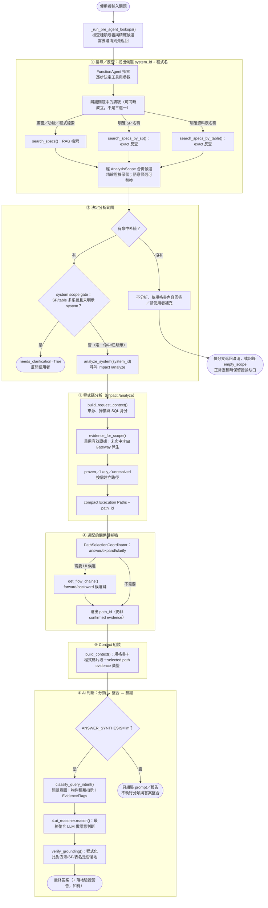
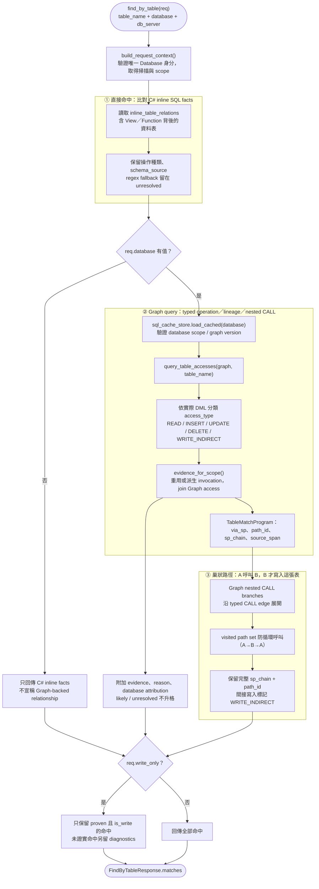
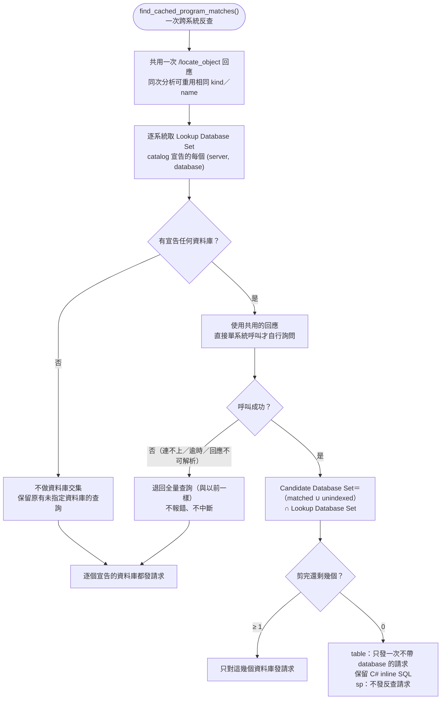
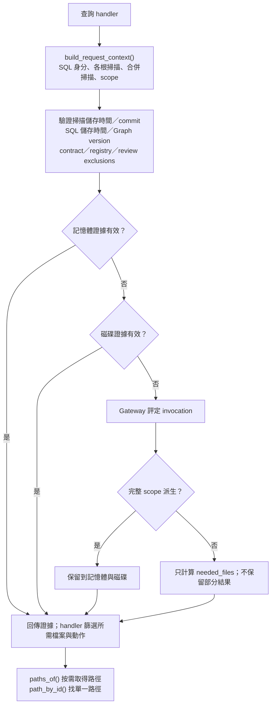
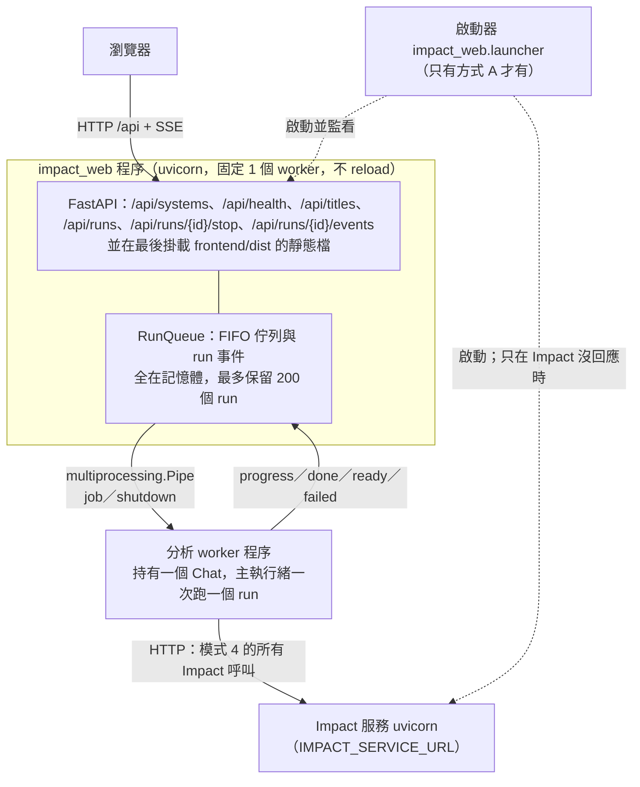
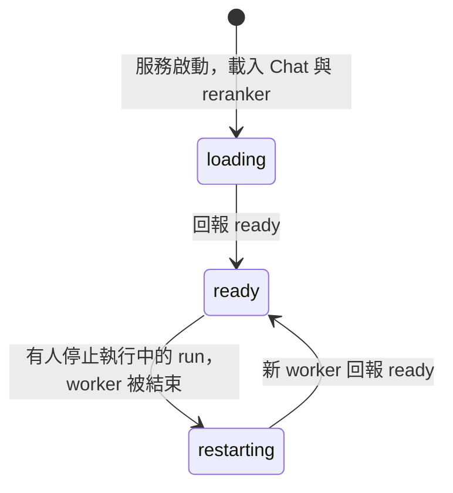
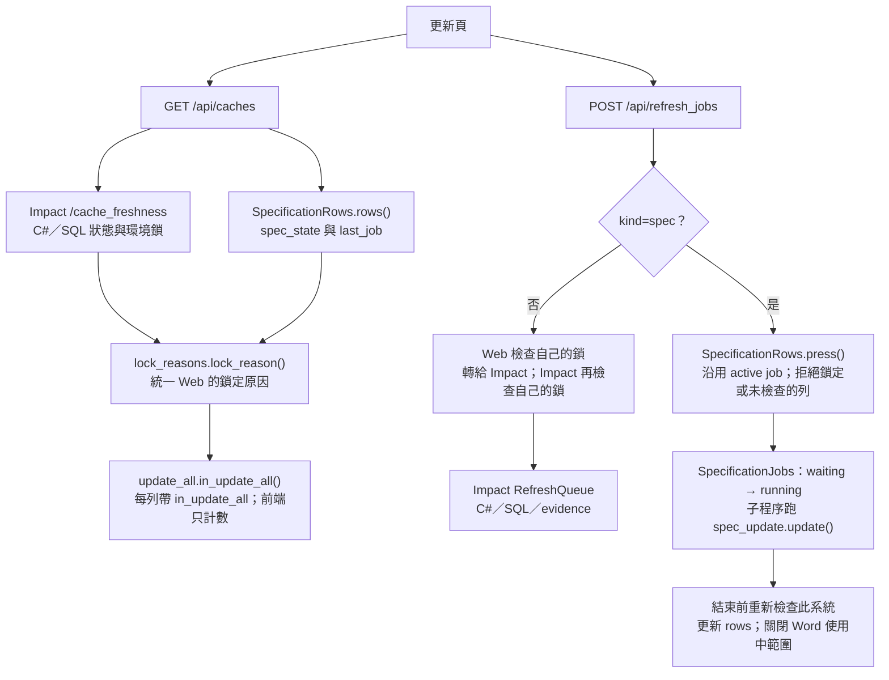

# 🧭 流程圖（進階）— 內部治理與逐步機制

本文件收錄 [流程圖.md](./流程圖.md) 省略的內部細節：`refresh_cli`／`refresh_sql_cli` 完整治理流程、agentic 模式（run_cli 模式 4／5）逐步的 AI 介入點、`find_by_table` 的讀寫判斷與巢狀路徑機制、Web 介面（`impact_web`）的啟動與執行內部。日常操作看主文件即可，這裡是給要維護/除錯這套系統的人看的。

> 🔖 **文件對照基準**：`Impact_analysis_system`／`YuHsien_20260630` 的 `d40d234`（2026-10-30）、`llamaindex-spec-rag`／`spec_extend_20260701` 的 `0e623ed`（2026-10-30）。見 [進階手冊.md § 文件對照基準](./進階手冊.md#文件對照基準)。

## 📑 目錄

1. [`refresh_cli` 完整流程（含 external wrapper contract preflight 與 atomic commit）](#1-refresh_cli-完整流程含-external-wrapper-contract-preflight-與-atomic-commit)
2. [`refresh_sql_cli` 完整流程](#2-refresh_sql_cli-完整流程)
3. [Agentic 模式（run_cli 模式 4／5）詳細步驟：AI 介入點](#3-agentic-模式run_cli-模式-45詳細步驟ai-介入點)
4. [`find_by_table` 寫入反查（access_type／巢狀路徑／evidence）流程](#4-find_by_table-寫入反查access_type巢狀路徑evidence流程)
5. [Web 介面（`impact_web`）內部：啟動器、佇列、worker、停止、澄清](#5-web-介面impact_web內部啟動器佇列worker停止澄清)

---

## 1. `refresh_cli` 完整流程（含 external wrapper contract preflight 與 atomic commit）

```mermaid
flowchart TD
    Start(["python -m impact_orch.refresh_cli &lt;system_id&gt; [system_id ...]"]) --> Health{"rag_client.health()<br/>Impact 服務在線？"}
    Health -- 否 --> Fail["提示先啟動 uvicorn service.api:app<br/>結束"]
    Health -- 是 --> Loop["for system_id in system_ids"]

    Loop --> Validate{"Catalog 有此 system_id？"}
    Validate -- 否 --> Invalid["此系統算失敗；繼續下一個"]
    Invalid --> NextCheck
    Validate -- 是 --> Call["rag_client.refresh(system=system_id)<br/>→ POST /refresh"]
    Call --> Api["service/api.py：refresh(req)<br/>_submit_csharp_job() 檢查環境鎖；同 key 沿用工作"]
    Api --> Queue["RefreshQueue：waiting → running<br/>與 SQL 更新共用，一次一個"]
    Queue --> RS["_csharp_refresh_run()<br/>analyze_service.refresh_source(source)"]

    RS --> Ensure["repo_manager.ensure_repo(source, refresh=True)"]
    Ensure --> Cloned{"repo 是否已 clone？<br/>（data/repos/&lt;project&gt;/&lt;repo&gt;）"}
    Cloned -- 否 --> Clone["AzureDevOpsFetcher.fetch()：clone"]
    Cloned -- 是 --> Pull["AzureDevOpsFetcher.fetch(update=True)：git pull"]
    Clone --> Scan
    Pull --> Scan

    Scan["rebuild_scan(root)<br/>略過快取，強制重新掃描"] --> Parser["ProjectScanner(root).scan_project(analyze_sp=False)"]
    Parser --> Detect["依實際檔案類型啟用 CSharpParser/ASPXParser/RazorParser/VueParser<br/>ProjectTypeDetector 另回報框架標籤"]
    Detect --> Extract["解析方法/呼叫鏈/SP 名稱/資料表/View 層欄位<br/>（不連資料庫）"]
    Extract --> Save["_save()：覆寫 data/scan_cache/&lt;hash&gt;.pkl + .meta.json"]

    Save --> Decompile["_populate_decompilation_proposals()<br/>完整 refresh 且未設定 selector 才嘗試<br/>按被引用 DLL 產生可驗證的 proposal"]
    Decompile --> Preflight["run_contract_preflight()<br/>依 scans、selector 與 registry 判定<br/>onboarding_status：selected／not_required／created／reused／conflicted／preflight_failed"]
    Preflight --> Reconcile["reconcile_refresh_wrappers()<br/>用 preflight 判定的 formal selector/registry<br/>分類本次觀察到的 external wrapper 呼叫 → wrapper_summary"]
    Reconcile --> GuardCheck{"完整 system refresh（非 --program 局部更新）<br/>且有 database（system_id）<br/>且 onboarding_status ∈ {created, reused}？"}
    GuardCheck -- 否 --> SkipCommit["依停止條件回報 transaction status<br/>program_scope／no_system_id／preflight_failed／not_required"]
    GuardCheck -- 是 --> Commit["commit_staged_contract_transaction()<br/>registry.json + system_catalog.json<br/>atomic two-file commit：先寫 transaction manifest，<br/>依序替換兩個檔案並驗證 hash，任一步失敗即 rollback"]
    SkipCommit --> Resp
    Commit --> Resp["回傳 source_root、files、inline facts 計數、<br/>wrapper_summary、contract_transaction、<br/>analysis_manifest.contract_revision_reference"]
    Resp --> Derive["evidence_refresh.then_derive()<br/>推導相關 scope 的證據<br/>derivation 失敗另列，不推翻來源更新"]
    Derive --> Poll["refresh_job.wait_for_job()<br/>輪詢 GET /refresh_jobs/job_id<br/>取得 succeeded／failed 與 result"]
    Poll --> Print["CLI 印出結果摘要<br/>空結果或顯示失敗也算此系統失敗"]
    Print --> NextCheck{"還有下一個 system_id？"}
    NextCheck -- 是 --> Loop
    NextCheck -- 否 --> End(["結束"])
```

> ⚠️ **常見誤解**：`rebuild_scan(root)` 本身就會**自動覆寫**磁碟快取，不需要手動刪除 `data/scan_cache/*.pkl`。但如果剛編輯過 `code_analyzer/`／`service/` 底下的解析器程式碼，**已在執行的 uvicorn 服務仍是記憶體裡的舊程式碼**（Python 不會熱重載），必須先重啟服務才能讓 `refresh_cli` 真正套用新邏輯。
>
> 本圖為不帶 `--program` 的完整更新。局部更新改走 `rag_client.refresh()` → `POST /refresh`，直接執行，不進佇列；列出已更新及找不到的程式，任一程式找不到即算該系統失敗。任一系統失敗時 CLI 結束碼為 `1`。`Ctrl+C` 嘗試取消目前等待的工作，停止提交後續系統，以 `130` 離開；執行中的工作仍繼續。
>
> 💡 **preflight／atomic commit**：`refresh_source()` 每次 refresh 都會跑 contract preflight 與 wrapper reconciliation，不需另外觸發；`onboarding_status=preflight_failed` **不會**讓整個 refresh 失敗，只會讓對應的 wrapper 呼叫留在 unresolved/review，其餘分析照常完成。只有「完整 system refresh（`--program` 局部更新一律不會）＋ 該 system 有 `database`＋ `onboarding_status` 為 `created` 或 `reused`」三個條件同時成立時，才會呼叫 `commit_staged_contract_transaction(trigger="refresh")` 把 staged 的 registry／catalog 正式寫入磁碟。人工的 `accept_external_wrapper_contract.py`（見 [進階手冊.md](./進階手冊.md#external-wrapper-contract-維護)）的 `--apply` 路徑現在也走同一個 `commit_staged_contract_transaction()`，只是傳入 `trigger="manual_acceptance"`——兩條入口在**何時觸發**上仍互不取代（refresh 是「自動偵測到足夠證據就自動沿用/建立」，`accept_*` 工具是「人工審核後明確套用」），但在**如何寫入**兩個檔案這件事上已共用同一套 atomic two-file commit／recovery 機制；manifest 裡的 `trigger` 欄位就是唯一用來分辨是哪條入口寫入的依據。

[⬆ 回目錄](#-目錄)

---

## 2. `refresh_sql_cli` 完整流程

```mermaid
flowchart TD
    Start(["python -m impact_orch.refresh_sql_cli &lt;database&gt; [database ...]<br/>／ --system_id &lt;system_id&gt;（可重複）<br/>／ --server &lt;server&gt; --database &lt;database&gt;（三選一，不可混用）"]) --> Health{"rag_client.health()<br/>Impact 服務在線？"}
    Health -- 否 --> Fail["提示先啟動 uvicorn service.api:app<br/>結束"]
    Health -- 是 --> Resolve["resolve_targets()：把命令列參數解析成掃描目標清單"]

    Resolve --> Direct{"給的是<br/>--server／--database？"}
    Direct -- 是 --> DirectTarget["直接用這一組 (server, database)<br/>不查 catalog、不查登錄檔（ADR-0006）"]

    Direct -- "否，給的是資料庫名稱" --> LookupName["source_resolver.resolve_registered_servers(name)<br/>查登錄檔（SQLServerData.json）"]
    LookupName --> NameCount{"登錄在幾台伺服器？"}
    NameCount -- 零台 --> NameErr["❌ TargetResolutionError<br/>附上可直接跑的 --server/--database 指令<br/>（不會順手寫進登錄檔）"]
    NameCount -- 一台 --> NameOne["直接用那一台，不必互動"]
    NameCount -- 多台 --> Tty{"有 terminal？<br/>sys.stdin.isatty()"}
    Tty -- 是 --> Prompt["列出候選（server／database／上次掃描時間<br/>← 惰性呼叫 GET /scan_records，只有這裡才打）<br/>照 (server, database) 排序，讓操作者選一個"]
    Tty -- 否 --> MultiErr["❌ TargetResolutionError<br/>列出每台候選各自可直接跑的指令，改用 --server 指定"]
    Prompt --> NameOne

    Direct -- "否，給的是 --system_id" --> Expand["source_resolver.resolve_databases(system_id)<br/>展開該系統宣告依賴的每一筆 {server, name}（ADR-0003）"]
    Expand --> Validate["逐筆呼叫 source_resolver.is_registered(server, name)<br/>核對是否登錄在 SQLServerData.json"]
    Validate --> ValidCheck{"每一筆都登錄過？"}
    ValidCheck -- 否 --> SysErr["❌ TargetResolutionError<br/>點名系統、那筆宣告、登錄檔路徑；不掃描任何一筆"]
    ValidCheck -- 是 --> SysTargets["展開成每筆宣告各自的 (server, name)"]

    DirectTarget --> Loop
    NameOne --> Loop
    SysTargets --> Loop

    Loop["for target in targets"] --> Cred["source_resolver.resolve_scan_credentials(target.server)<br/>讀 uid_env/pwd_env 指名的 .env 變數（ADR-0004）；<br/>半填或讀不到值直接報錯，不退回全域身分"]
    Cred --> Call["rag_client.refresh_sql_database(server, db_name)<br/>→ POST /refresh_sql {database: cache_key(server,db_name), server, db_name, db_user_id, db_password, job_id}"]
    Call -.收到 job 後輪詢.-> Poll["refresh_job.wait_for_job()<br/>每 0.5 秒讀 GET /refresh_jobs/job_id<br/>排隊時顯示位置，執行時顯示 tqdm"]

    Call --> Api["service/api.py：refresh_sql(req)<br/>_submit_sql_job() 驗證身分與環境鎖"]
    Api --> Queue["RefreshQueue：waiting → running<br/>與 C# 更新共用，一次一個"]
    Queue --> RS["analyze_service.refresh_sql_source()<br/>建立 CacheIdentity(server, database)<br/>一份涵蓋庫內全部 schema"]

    RS --> Dump["sql_cache_store.get_or_dump(..., refresh=True)<br/>略過快取，強制重新連線"]
    Dump --> Connect["SQLAnalyzer(server=server, database_name=db_name).connect()<br/>settings.build_database_config() 現組設定"]
    Connect --> DumpAll["dump_all_sql_objects()<br/>list_objects() 一次列出每個 schema 的物件"]

    DumpAll --> P1["各 SP（帶自己的 schema）→ 逐一 _get_sp_basic_info()<br/>（定義 + 參數）"]
    P1 --> GraphBuild["SQL Execution Graph builder<br/>typed nodes/relationships + ScriptDom AST<br/>建立 DbInvocation、CALL 與 terminal operation"]
    DumpAll --> P2["各 View → 逐一 get_object_definition()"]
    DumpAll --> P3["各 Function → 逐一 get_object_definition()<br/>+ get_function_parameters()"]
    DumpAll --> P4["各資料表 → 逐一 get_table_columns()"]

    P2 --> GraphBuild
    P3 --> GraphBuild
    P4 --> GraphBuild
    GraphBuild --> Lineage["展開暫存表 lineage（資料來源追蹤）"]
    Lineage --> ValidateCache["sql_cache_store 驗證<br/>_SQL_CACHE_VERSION + graph version + database scope"]
    ValidateCache --> Save

    Save["_save()：覆寫<br/>data/sql_cache/&lt;cache_key&gt;.json + .meta.json<br/>接著建置並寫出 &lt;cache_key&gt;.index.json<br/>（Object Location Index；寫索引失敗不會回滾已成功的快取）"] --> Resp["回傳 {database, procedures, views, functions, tables} 數量"]
    Resp --> Derive["evidence_refresh.then_derive()<br/>推導受影響 scope 的證據"]
    Derive --> Print["job 成為 succeeded；CLI 顯示各類別數量<br/>失敗則為 failed"]
    Poll -.收到終止狀態.-> Print
    Print --> NextCheck{"還有下一個 target？"}
    NextCheck -- 是 --> Loop
    NextCheck -- 否 --> End(["結束"])
```

> 💡 之後問問題時，`sp_fetcher.py`／`view_fetcher.py`／`udf_fetcher.py` 讀取已驗證的本機 SQL cache；正式 Graph/path consumer 不會因為缺少某個物件而退回逐物件即時查詢。若 cache 不存在、過期或 database scope 不符，正式 Graph operation 會回報 `sql_execution_graph_required`，而不是猜測 relationship。
>
> ⚠️ 資料庫是**多系統共用資源**（不像 git repo 是每個系統各自一份），跟 `refresh_cli`（更新程式碼）是不同軸的更新指令，需要個別觸發。
>
> 🧱 **SQL Execution Graph 目前是 `graph_version 14`**。相較舊版，建圖多了三條規則：非 DML 陳述式（如 `SET @x = (SELECT ... FROM T)`、`RETURN (SELECT ...)`）讀取資料表時，也產生一個 `SELECT` operation（ADR-0041，v12）；呼叫其他資料庫的 SP，target id 保留 `{database}.{schema}.{name}`，不會誤對到本庫同名 SP（ADR-0042，v13）；`SELECT ... INTO #t` 遮蔽呼叫端同名的暫存表，暫存表 lineage 不跨過這種呼叫（ADR-0043，v14）。舊快取請跑 `python tools/repair_sql_execution_graphs.py` 重建。
>
> 📌 **位置參數是資料庫名稱，不是系統代號**（ADR-0006）：`refresh_sql_cli STC` 掃的是名叫 `STC` 的資料庫，要掃「STC 系統宣告依賴的每個資料庫」請改用 `--system_id STC`。三種寫法（資料庫名稱、`--system_id`、`--server`/`--database`）不能混用；`--system_id` 展開前會先核對每筆宣告是否真的登錄過（ADR-0003），核對失敗時不掃描任何一筆。`GET /scan_records`（Impact 端新端點）只在真的要列出多台候選時才會被打一次，一台候選或沒有 terminal 的報錯路徑完全不碰它。

[⬆ 回目錄](#-目錄)

---

## 3. Agentic 模式（run_cli 模式 4／5）詳細步驟：AI 介入點

模式 4／5 都走 `run_impact_analysis_agentic()`。`AgentRoutingPolicy`（代理路由政策）控制已標記名稱的查詢時機。`AnalysisScope`（分析範圍管理器）控制探索與鎖定。下表使用預設 `SCOPE_LOCK_POLICY=full`。

| 階段 | 模式 4 | 模式 5 |
|------|--------|--------|
| Agent 前置查詢 | 檢查未標記名稱的種類歧義，查明程式檔名 | 同左；另對已標記 SP／資料表執行精確反查 |
| 第一輪工具 | `search_specs`、`search_specs_by_sp`、`search_specs_by_table`、`analyze_system`、`get_flow_chains`、`collect_path_evidence`（6 支） | 移除兩支精確反查工具（4 支） |
| 鎖定後補證據 | 使用獨立 Locked Phase（鎖定階段）agent | 同左；兩模式共用 4 支工具 |

鎖定階段工具為 `search_specs_scoped`、`analyze_system`、`get_flow_chains`、`collect_path_evidence`。`search_specs()` 呼叫 `Chat.retrieve_spec_sources()`，只取得規格書來源，不先生成答案。

內部有**五種完全不同性質的「AI/模型」角色**，很容易被混為一談：

| 角色 | 使用的模型 | 是不是真正的「推理判斷」 | 出現在哪一步 |
|---|---|---|---|
| 1. Router Agent | `cfg.AGENT_ROUTER_MODEL`（`FunctionAgent`） | ✅ 真的 LLM 推理 | 工具選擇、system scope／澄清判斷與工具參數 |
| 2. Embedding 相似度 | `cfg.OPENAI_EMBEDDING_MODEL` | ❌ 不是推理，是固定的向量 cosine 相似度計算 | 候選錪點、程式碼片段、畫面區塊與規格書分段挑選 |
| 3. 片段一句話摘要 | `cfg.OPENAI_LOW_MODEL` | ✅ 是 LLM，但只做摘要不做決策 | SP/View/UDF/前端 script 的「AI 摘要」（`USE_CODE_ANNOTATION=true` 時） |
| 4. 證據充分性裁決 | `cfg.OPENAI_LOW_MODEL` | ✅ 是 LLM，但只判「還缺什麼類型的證據」，不改寫 evidence | 每一輪 agent 跑完之後（見下方證據充分性迴圈） |
| 5. 最終整合答案 | `cfg.OPENAI_MODEL`（`ai_reasoner.reason()`） | ✅✅ 真正做「這是哪個分支/這條鏈才對」的實質判斷 | 完整 context 組裝後 |

Router Agent 始終使用模型。證據裁決由 `SUFFICIENCY_JUDGE` 控制。路徑選擇另由 `PATH_SELECTION` 控制。問題意圖分類與最終整合只在 `ANSWER_SYNTHESIS=llm` 執行。Embedding 與注記另讀各自設定。

> 💡 **一句話總結**：①②只決定「查哪些系統/程式、要不要反問」，③才第一次真正碰程式碼，④是選配的關係鏈補強，⑤把①③④的產物彙整成一份 context，⑥才是真正的語意判斷發生的地方——`proven`、`likely`、`unresolved` 的界線不能由 LLM 改寫。

### 環繞在外的三道閘門

上圖的 ①～⑥ 是「一輪」。實際跑起來還有三道環繞在外面的機制，都在 spec-rag 端，不改變 evidence 判定：

| 機制 | 什麼時候發生 | 做的事 |
|---|---|---|
| **Object Kind Ambiguity（物件種類歧義）** | ① 之前，程式化判斷，不呼叫 agent | 問題裡出現一個沒有標示種類的名稱，而它同時可能是預存程序、資料表或程式代號時，直接列出每一種解讀請使用者選（terminal 用上下鍵，非 terminal 改成輸入關鍵字），不猜、也不同時全查 |
| **Locked Analysis Scope（分析範圍鎖定）** | 預設政策下，第一輪 agent 結束後 | `AnalysisScope.lock()` 保存候選身分。後續使用獨立鎖定階段 agent，只深化既有範圍；backward 範圍外程式記成 Evidence Gap |
| **Evidence Sufficiency Loop（證據充分性迴圈）** | 每一輪 ①～④ 跑完之後 | 用低成本模型判斷「證據夠不夠」；不夠就指出缺哪一類（規格書／C# 原始碼／SP 定義／關係鏈／path evidence），對應到該呼叫的工具，再跑一輪。最多 `AGENT_MAX_SUFFICIENCY_ROUNDS` 輪；某一輪完全沒有新增證據就直接停（不再多花一次裁決）。裁決後由程式套用 **Unfillable Kind Filter**（見下） |

**第四道（只有 Web 介面有）：Pinned System（釘選系統）。** 分析師在對話上釘選一個系統後，每次 run 開始前就限制範圍：規格書檢索、`search_specs_by_sp`／`search_specs_by_table` 的精確反查命中、`analyze_system`、`get_flow_chains` 都只收釘選系統內的結果，並由釘選取代「多系統命中時反問」。釘選系統以外的命中不分析，列為 **Unanalysed Match（Out-of-pin Match）**，答案與細節區都會列出，且回覆一律註明「分析範圍限定於釘選系統，不能據此推論其他系統不受影響」。CLI 模式 4 沒有釘選；但兩邊都改成「被攔下的系統不再進入 `get_flow_chains` 與 Locked Analysis Scope」，答案也會把問題沒點名的系統列為 Unanalysed Match。

> 💡 停止原因（`sufficient`／`round_limit`／`no_progress`／`empty_scope` 等）與每一次 HTTP 重試，都會寫進最終報告末尾的「證據蒐集」附錄，不經過 AI 改寫。查不到的東西會列成 **Evidence Gap**，並附一句「換句話怎麼問」的建議。

**Unfillable Kind Filter（無法補齊的種類過濾）**：裁決說「缺某類證據」之後，由程式（不是模型）移除「再跑一輪也補不到」的種類，避免白白多跑一輪。裁決原文仍留在報告，被移除的種類另列。規則如下：

| 缺的證據種類 | 對應工具 | 什麼時候移除 |
|---|---|---|
| `csharp_source`、`stored_procedure_definitions` | `analyze_system` | 已經沒有任何 `analyze_system` 呼叫能再增加分析 |
| `relationship_chains` | `get_flow_chains` | 本次 run 的 `AGENT_MAX_FLOW_CHAIN_CALLS` 已用完 |
| `path_evidence` | `collect_path_evidence` | 路徑選擇迴圈已跑過，且分析過的系統集合沒有變 |
| `specification` | `search_specs_scoped` | 鎖定範圍內每支程式的已登錄規格書檔案都已在規格書證據裡（鎖定前不移除） |

`SUFFICIENCY_JUDGE=deterministic` 固定回報足夠，不再追加裁決輪次。跨系統反查與重試也使用同次 `RequestBudget`（請求額度）。額度耗盡時保留已讀結果，並列出未讀系統。未證實命中不會擴大正式範圍。

### `get_flow_chains`：forward／backward 兩種方向

| 方向 | 觸發時機 | 需要的參數 | 內部行為 |
|---|---|---|---|
| `forward` | 問「某個畫面操作／UI 動作」的影響（含回復/修正類問題） | `program_name` + agent 判斷的 `ui_action_hint` | 取得 `view_layer` → 攤平候選 → embedding 依 `ui_action_hint` 排序取前 5 → 逐一組鏈到 SP/資料表。組鏈時沿每個呼叫的 **Bound Call Target**（實際綁定的方法）進入 service 等其他檔案（ADR-0044）；沒走的分支與找不到綁定目標的呼叫列在 diagnostics |
| `backward` | 問「異動某張資料表/欄位」會影響哪些程式 | `table_name` | 直接反查 `(program, method)` 候選，再沿 Bound Call Target 往回走到入口動作及其 Program Screens；無法綁定的呼叫與未證實的 SP 呼叫路徑（含 Evidence Status）顯示在文字輸出的 diagnostics |

兩種方向都只有在**已經對該 system 呼叫過 `analyze_system` 之後**才允許呼叫，且都受 `AGENT_MAX_FLOW_CHAIN_CALLS` 呼叫次數上限保護。`forward` 對 GridView 列命令按鈕（`OnRowDeleting`/`OnRowEditing`/`OnRowUpdating`/`OnRowCancelingEdit`/`OnRowCommand`）有特別處理：這類事件語法上只掛在 grid 容器本身，`_flatten_ui_field_events()` 會把該 grid 底下「有文字但沒有自己事件」的每個欄位（如按鈕文字「取消」）跟容器層級的 handler 配對，合成出「真實按鈕文字 + 真實 handler」的候選。

[⬆ 回目錄](#-目錄)

---

## 4. `find_by_table` 寫入反查（access_type／巢狀路徑／evidence）流程

`/find_by_table` 同時處理 C# inline SQL 與資料庫 Graph。`inline_table_relations.py`（內嵌資料表關係模組）提供直接與間接關係。`query_table_accesses()` 查詢 Graph 路徑。回應使用 `evidence_status`；服務同時計算 `is_write`。只有 `proven` 進入正式關係。

> 💡 **Graph readiness 是查詢前置條件**：`database` 對應的 SQL cache 必須通過版本、Graph version 與 database scope 驗證；缺失或過期時正式 endpoint 回 HTTP 409（`sql_execution_graph_required`）。`/refresh_jobs/{job_id}` 的 `succeeded` 只表示 refresh worker 結束，不取代這個 readiness gate。
>
> 💡 **非 DML 的讀取也算 SELECT**：`SET @x = (SELECT ... FROM T)`、`RETURN (SELECT ...)` 這類陳述式讀到資料表時，Graph 會有 `SELECT` operation（ADR-0041，`graph_version 12`），所以 `/find_by_table` 不會漏掉只在這種陳述式裡讀表的 SP。
>
> 💡 **`write_only` 篩選**：C# inline SQL 的 `INSERT`/`UPDATE`/`DELETE` 與 Graph 的 `WRITE`/`WRITE_INDIRECT`/具體 DML operation 都可納入寫入篩選；無法判斷的 evidence 不會因 `write_only` 而被猜成寫入。CLI 模式 3（資料表反查）目前不暴露這個開關（維持回傳讀寫命中），API 與 Agent tool 可傳 `write_only=True`。

### 發請求之前：Candidate Database Set（候選資料庫集合）

上圖是 **一個資料庫** 的處理流程。一個 System 可能宣告好幾個資料庫，舊做法是逐個都發一次請求、逐個都把快取整份讀開（最大一份約 105 MB）。現在 spec-rag 先做一步剪枝：

> 💡 **剪枝是權威的，但只會變慢不會變錯**：`/locate_object` 只看 Object Location Index，完全不開 SQL 快取。`matched`＝索引新鮮且持有這個名稱；`unindexed`＝索引缺席／過期／版本不符，服務不能代答，必須整份讀；**兩份都沒出現的資料庫才是真的被剪掉**。索引建立時寧可多報不可少報，所以一份過期的索引只會少剪一點（多讀一份快取），不會把真正的答案剪掉。見 `docs/adr/0012-object-location-index-authoritative-pruning.md`。

### 服務端的派生證據重用

`derived_execution_evidence.evidence_for_scope()` 管理 Derived Execution Evidence（派生執行證據）。五條查詢共用它：`analyze`、`find_by_sp`、`find_by_table`、`flow_chain`、`get_path_evidence`。

派生層的 `evidence_for_scope(..., refresh=True)` 跳過兩層重用；這不是提問請求的 `refresh`。提問的 `refresh` 不會 pull、掃描或重建來源快取。程式碼、SQL 或治理設定改變時，舊證據失效。記憶體採 LRU（優先淘汰最久未使用資料）；預設保留 100 個 scope。磁碟重用可跨服務重啟。

完整 C#／SQL Refresh Job 最後由 `evidence_refresh.then_derive()` 預先推導相關 scope。服務啟動或讀取設定時發現 wrapper selector、registry 或 review exclusions 變更，會排入 `kind=evidence` 的工作。它沒有獨立的更新按鈕。提問仍可在有效證據缺席時推導，並透過 `/derivation_progress` 回報階段。

[⬆ 回目錄](#-目錄)

---

## 5. Web 介面（`impact_web`）內部：啟動器、佇列、worker、停止、澄清

操作步驟在 [使用說明書.md § 啟動 Web 介面](./使用說明書.md#-啟動-web-介面)，整體資料流在 [流程圖.md § 5](./流程圖.md#5-web-介面怎麼啟動一次提問怎麼跑)。這一節說明維護與除錯時會碰到的內部機制。

### 5-1 程序配置

固定 1 個 uvicorn worker、不 reload 是刻意的：多個 uvicorn worker 會各有自己的佇列與分析 worker，打亂排隊順序與停止；reload 會在每次程式碼變動時重啟分析 worker。`python -m impact_web` 不開放這些選項。

### 5-2 分析 worker 的狀態

- `GET /api/health` 回傳 `impact_service_reachable`、`worker_state`、`worker_error` 與 `evidence_derivation`（Impact 正在為問題推導證據）。
- 第一次載入時，排隊的 run 看到沒有位置的 `queued`；重啟時看到 `restarting`。worker ready 之後，各個 run 回到原本的排隊位置。
- worker 載入失敗時，`worker_state` 不變，`worker_error` 會帶 `分析 worker 載入失敗：…` 的訊息；之後的 run 以 `error` 結束。
- worker 程序意外結束時，進行中的 run 以 `error` 結束，`worker_error` 與頁面訊息都是 `分析 worker 已結束，請重新啟動服務`。此時需要重新啟動 Web 介面。

### 5-3 一個 run 的結尾事件與停止

| 項目 | 內容 |
|---|---|
| 結尾事件 | `answered`（有答案）、`clarification`（agent 反問）、`stopped`（被停止）、`error`（環境錯誤）。每個 run 在其中一個出現後就結束 |
| 沒有答案的結尾 | `stopped`、`error`：分析師的澄清回覆沒有得到結果，澄清會還給他再回覆一次 |
| 事件重播 | `GET /api/runs/{id}/events` 晚一步連上也會從頭收到；頁面重新載入後靠這點接回執行中的 run |
| 停止的三種結果 | `stopping`：run 已交給 worker，worker 被殺掉再重啟；`cancelled`：還在排隊或在等 worker 載入，只被移出佇列；`finished`：run 已結束，沒東西可停 |
| 停止不留半成品 | 被停止的 run 不顯示任何部分結果；問題留在對話裡，標示「已停止」，可一鍵重送 |
| 兩個分頁回覆同一個澄清 | 第一個啟動 run；第二個收到 HTTP 409，內容帶著先接手的 `run_id`，頁面接上它 |
| 釘選不在目錄裡 | `POST /api/runs` 回 HTTP 400，不會靜默變成「什麼都沒找到」 |

### 5-4 澄清：CLI 與 Web 共用同一個模組

`impact_orch/clarification_turn.py` 同時給 CLI 與 Web 使用，所以「補充問題的規則」與「物件種類改寫問題」兩邊不會分岔。Web 的做法：

1. agent 反問時，結尾事件 `clarification` 帶著 pending 狀態，頁面把它存起來。
2. 分析師回覆時，`POST /api/runs` 帶 `pending_clarification` 與回覆（自由文字放 `question`；物件種類放 `object_kind_reply`，格式是名稱對應選定種類）。
3. 空白回覆＝放棄：API 回 `abandoned`，不啟動 run。
4. 換釘選會讓還在等待的澄清作廢，下一則訊息視為新問題。

### 5-5 標題端點

`POST /api/titles` 用 `OPENAI_LOW_MODEL` 呼叫一次（逾時 20 秒、不重試）寫出最多 15 字的標題。失敗或沒寫出內容時，改用問題的前 30 字（被截斷時加 `…`）。標題不進分析佇列，分析在跑時也能立刻回應。

### 5-6 啟動器怎麼停止服務

啟動器自己啟動的每個子程序都在獨立的程序群組裡，主控台的 `Ctrl+C` 只打到啟動器。停止順序是先 Web、再自己啟動的 Impact（重用的 Impact 不動）。

1. 第一個停止訊號（`Ctrl+C`、SIGTERM、視窗關閉、SIGBREAK）中斷等待；之後的訊號一律忽略，直到收尾結束。
2. 對子程序群組送出溫和結束要求（Windows 是 `CTRL_BREAK_EVENT`，macOS／Linux 是 SIGINT），最多等 10 秒。
3. 逾時就強制結束整棵程序樹（Windows 用 `taskkill /F /T`，`taskkill` 最多等 10 秒；macOS／Linux 用 `killpg(SIGKILL)`），再多等最多 5 秒回收。每個服務最多約 25 秒。
4. 強制結束是必要的：開著的 SSE 連線會讓 uvicorn 的溫和關閉等很久。

啟動器不會監看它啟動的 Impact 服務：Impact 中途死掉時，啟動器不會發現，頁面會透過 `/api/health` 顯示 Impact 無回應。

### 5-7 更新頁：規格書列、鎖定與全部更新

| 決策 | 負責模組與規則 |
|------|----------------|
| 規格書列 | `specifications.py` 的 `SpecificationRows` 持有 job line、檢查結果、提交與取消規則 |
| 鎖定原因 | `lock_reasons.py` 統一計算；規格書先採 ESP／Word 失敗，再採 Baseline；SQL／C# 保留 Web 與 Impact 的鎖 |
| 全部更新 | `update_all.py` 選擇無鎖、無 active job 的列；spec 只選 `behind_esp`／`needs_index`，C#／SQL 只選 `outdated` |
| 工作狀態 | `job_status.py` 的 `JobStatus`／`is_active()` 共用 `waiting`、`running` 等狀態；`contract/update_page_contract.json` 核對前後端狀態與階段名稱 |
| Impact 未回答環境檢查 | `environment.py` 記錄 `impact_answered=false`；「全部更新」不提交 SQL／C#，仍可提交符合條件的規格書 |
| Impact 提交失敗 | 規格書仍嘗試排隊，但 API 保留 Impact 錯誤；不可因錯誤回應就推論沒有任何規格書工作 |

三條佇列互相獨立：Web 分析 `RunQueue`、Web 規格書 `SpecificationJobs`、Impact 快取 `RefreshQueue`。它們都不持久化；重啟對應服務後不會自動恢復工作。

[⬆ 回目錄](#-目錄)
